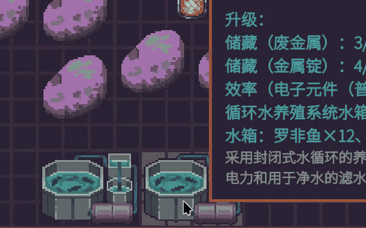

# Drag to Feed



A mod for Probably Stolen. Drag food onto an animal cage or aquaculture system to put it in the feed dispenser inside. Remember to right click a dispenser to enable Auto Blend.

拖拽喂食：把食物拖到动物笼或循环水养殖系统上，会放进里面的饲料分配器。记得右键分配器开启自动混合。

## Install

Subscribe on the [Steam Workshop](https://steamcommunity.com/sharedfiles/filedetails/?id=3844382629), or copy the `DragToFeed` folder into the game's `Mods` folder. Then activate the mod in the game's mod list and restart.

## Build

Needs Mono's C# compiler (`csc` or `mcs`) and the game installed.

```sh
./build.sh            # builds into dist/DragToFeed
./build.sh install    # also copies it into the game's Mods folder
```

Set `GAME_DIR` if the game is not in the default Steam library. Built for game version 1.0.0.16.
